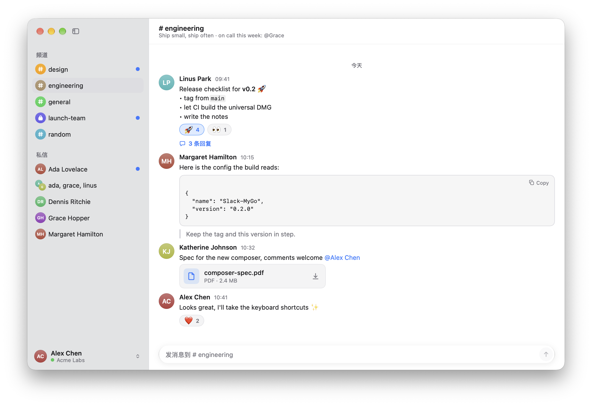
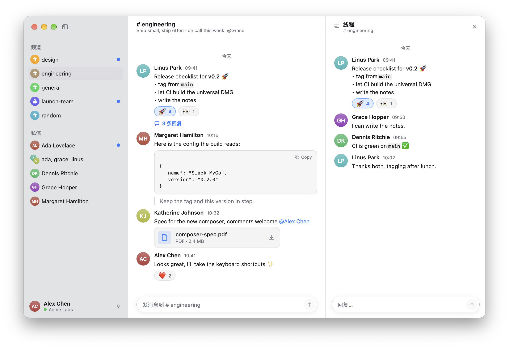

# MySlack

A lightweight, unofficial Slack client for macOS, written in Go with
[MyGo](https://github.com/egoist/mygo)'s native UI. No Electron, no web view,
no JavaScript: the whole interface is drawn by MyGo on the GPU, styled after
macOS 27.



## Footprint

One process, measured on an Apple Silicon Mac, signed in to a real workspace
with its channels open:

| | |
|---|---|
| Memory, idle | **85 MB** (the Memory column of Activity Monitor; 120 MB right after loading, before the graphics buffers are released) |
| CPU, idle | 0.0–0.1% |
| Processes | 1, with 22 threads |
| App size | 14 MB app, 5.3 MB disk image (Apple Silicon) |

Measured with `footprint` and `top`. Memory grows with the channels opened
(their last 100 messages each) and the avatars and pictures loaded.

## Features

- Channels, private channels, direct and group messages, in a sidebar of the
  system's material with avatars, as Messages shows people
- Messages in Slack's formatting: bold, italic, strikethrough, code, code
  blocks, quotes, lists, links, mentions and emoji shortcodes
- Real-time updates over Slack's socket: new messages, edits, deletions,
  replies and reactions
- Threads in an inspector beside the channel
- Profiles: click an avatar or a name for the person's title, status and
  local time, and to write to them
- Reactions: add any emoji from a searchable picker, toggle them in place
- Files: download to Downloads with progress, open or reveal in Finder;
  pictures as thumbnails that open in Preview
- Desktop notifications for direct messages and mentions, and an unread
  count on the Dock
- Settings (⌘,): appearance, text size, compact mode, ⌘↩ to send,
  notifications
- Session kept in the macOS Keychain



## Install

Download the disk image from the
[latest release](https://github.com/mrzzmrzz/MySlack/releases/latest),
open it and drag MySlack to Applications.

Releases built without a Developer ID are signed ad hoc: the first time,
right-click the app and choose Open, or allow it under System Settings ›
Privacy & Security.

## Sign in

MySlack signs in with the session of Slack's web client: an `xoxc-` token
and the `d` cookie that goes with it.

- **From Safari**: sign in at [app.slack.com](https://app.slack.com) in
  Safari, then run

  ```sh
  go run ./cmd/import-safari            # or -team <name> with several workspaces
  ```

  It reads the session from Safari, checks it, and keeps it in the Keychain
  where the app finds it. Your terminal needs Full Disk Access to read
  Safari's data.

- **By hand**: in the browser's developer tools on app.slack.com, run
  `Object.values(JSON.parse(localStorage.localConfig_v2).teams)[0].token`
  in the console for the token, and copy the `d` cookie from the cookies
  of `slack.com`. Paste both into the app's sign-in window.

> [!WARNING]
> Using a session token outside Slack's own clients may be against Slack's
> terms of service, and your workspace's administrators may not allow it.
> Use it at your own risk, on workspaces where you may.

## Build

Requires Go 1.27.3 or later, on an Apple Silicon Mac.

```sh
go tool mygo dev      # run with live reload
CGO_ENABLED=0 go test ./...
go tool mygo build -platform darwin/arm64  # build/darwin-arm64/MySlack.app and its .dmg
```

`SLACK_MYGO_DEMO=1` starts the app on a made-up workspace, offline, as in the
screenshots; `SLACK_MYGO_DEMO=thread` opens a thread too.

The code is small:

| Path | What |
|---|---|
| `slack/` | Web API client, real-time socket, mrkdwn to Markdown, emoji table |
| `view.go` | the main window |
| `settings.go` | the settings window |
| `avatar.go` | avatars |
| `main.go` | state, sign-in, events, notifications, menus |
| `cmd/import-safari` | imports the session from Safari |

## Releases

Pushing a tag `v<version>` matching `version` in `mygo.json` builds an
Apple Silicon disk image and publishes it as a GitHub release.

## License

[MIT](LICENSE).

Slack and the Slack logo are trademarks of Slack Technologies, LLC, a
Salesforce company. This project is not affiliated with, endorsed by or
sponsored by Slack or Salesforce.
